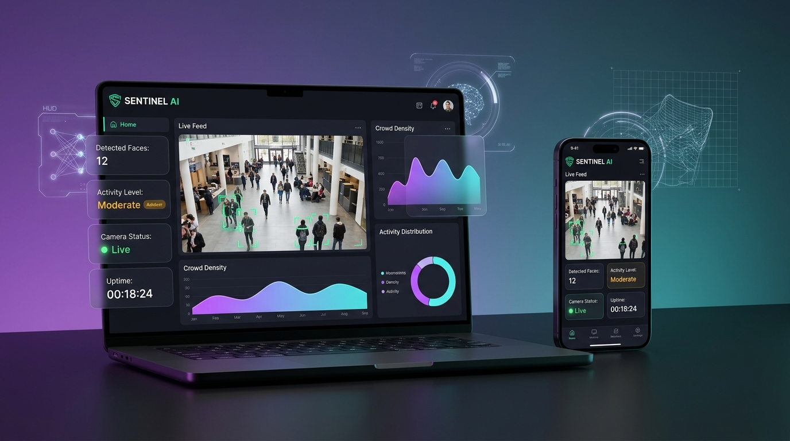

# 🚀 SENTINEL AI - Smart AI Monitoring System

[](https://sairajbhandalkar61-ctrl.github.io/smart-ai-monitoring-system/)
[](https://share.streamlit.io/)
[](https://python.org)
[](https://tensorflow.org)
[](https://fastapi.tiangolo.com)

An end-to-end AI-powered surveillance and crowd analytics platform with real-time computer vision detection, deep learning activity classification (ANN), and a high-performance **120Hz responsive dashboard** accessible across desktop, tablet, and mobile devices worldwide.

---

## 🌐 24/7 Live Cloud Dashboard

👉 **Open Live Link Anywhere**: [https://sairajbhandalkar61-ctrl.github.io/smart-ai-monitoring-system/](https://sairajbhandalkar61-ctrl.github.io/smart-ai-monitoring-system/)

> Works on **any mobile phone, tablet, and PC** with full touch controls, webcam integration, real-time Chart.js telemetry, in-browser ANN neural inference, and instant snapshots.

---

## 📸 System Showcase



---

## 🎯 Key Features

- **Multi-Cascade OpenCV Detection**: Real-time frontal, profile, and upper-body person detection with Non-Maximum Suppression (NMS) to eliminate duplicate bounding boxes.
- **Deep Learning Classification (ANN)**: Multi-layer Artificial Neural Network trained on pedestrian count, temporal hours, and movement delta dynamics to classify crowd state into `Low`, `Moderate`, and `High`.
- **120Hz High-Refresh Dashboard**: GPU-accelerated HTML5 Canvas with sub-pixel interpolation for ultra-smooth rendering, custom radar sweeps, and interactive bounding-box inspectors.
- **Mobile-First Responsive Design**: Tailored viewport with 3-column top metrics, side-by-side activity cards, quick-action floating controls, and native bottom navigation.
- **Zero-Dependency Cloud Hosting**: Pre-compiled client-side ANN engine allows the live frontend to run 24/7 on GitHub Pages without requiring local uvicorn server processes.
- **FastAPI & Streamlit Backends**: Dual deployment options supporting REST API endpoints (`/api/predict`, `/api/detect`, `/api/stats`) and Streamlit cloud hosting.

---

## 🧠 Tech Stack

- **Computer Vision**: OpenCV (Haar Cascades + NMS fusion)
- **Deep Learning**: TensorFlow / Keras (Artificial Neural Network)
- **Data Engineering**: NumPy, Pandas, Scikit-learn, Joblib
- **Backends**: FastAPI, Uvicorn, Streamlit
- **Frontend & Visuals**: HTML5 Canvas, CSS3 Glassmorphism, Chart.js, Vanilla JS (120 FPS requestAnimationFrame loop)
- **Cloud Deployment**: GitHub Pages (24/7 Live Web), Streamlit Community Cloud, Render

---

## 📁 Project Structure

```text
smart-ai-monitoring-system/
│── index.html                         # Root entrypoint for GitHub Pages 24/7 cloud hosting
│── app.py                             # Streamlit web application
│── server.py                          # FastAPI production server with REST endpoints
│── detection.py                       # OpenCV multi-cascade person detection with NMS
│── ml_model.py                        # TensorFlow ANN model predictor & confidence scorer
│── llm.py                             # Rule-based and LLM security report generator
│── analytics.py                       # Trend computation and threshold analytics
│── requirements.txt                   # Cloud-ready dependencies (opencv-python-headless)
│── render.yaml                        # Render cloud backend configuration
│── sentinel_ai_linkedin_showcase.jpg  # Project showcase banner & thumbnail
│── surveillance_sample.jpg            # Reference surveillance footage
│
├── .github/
│   └── workflows/
│       └── deploy.yml                 # Automated GitHub Pages CI/CD workflow
│
├── static/
│   ├── index.html                     # Backup standalone template
│   ├── style.css                      # 120Hz responsive glassmorphism styles
│   ├── app.js                         # 120 FPS canvas engine & client ANN fallback
│   └── sentinel_ai_linkedin_showcase.jpg
│
└── models/
    ├── dl_model.h5                    # Trained TensorFlow ANN weights
    ├── scaler.pkl                     # StandardScaler transform
    └── label_encoder.pkl              # Class label encoder
```

---

## 🚀 Running Locally

### 1. Clone the repository
```bash
git clone https://github.com/sairajbhandalkar61-ctrl/smart-ai-monitoring-system.git
cd smart-ai-monitoring-system
```

### 2. Install dependencies
```bash
pip install -r requirements.txt
```

### 3. Launch the 120Hz Web Dashboard (FastAPI)
```bash
uvicorn server:app --reload --port 8000
```
Visit: `http://localhost:8000`

### 4. Or launch the Streamlit App
```bash
streamlit run app.py
```
Visit: `http://localhost:8501`

---

## ☁️ Cloud Deployment Options

1. **GitHub Pages (Frontend - 24/7 Zero Cost)**:
   - Already configured! Automatically deploys from the `main` or `gh-pages` branch.
   - URL: `https://sairajbhandalkar61-ctrl.github.io/smart-ai-monitoring-system/`

2. **Streamlit Community Cloud (Python UI)**:
   - Go to [share.streamlit.io](https://share.streamlit.io/)
   - Connect repository `sairajbhandalkar61-ctrl/smart-ai-monitoring-system`
   - Set Main file path: `app.py` -> Click **Deploy**

3. **Render (FastAPI REST Backend)**:
   - Connect repository to [render.com](https://render.com/)
   - It will automatically read `render.yaml` and deploy `server.py`.

---

## 🧑‍💻 Author

**Sairaj Bhandalkar**  
MCA (Data Science) | MIT ADT University  
- **GitHub**: [@sairajbhandalkar61-ctrl](https://github.com/sairajbhandalkar61-ctrl)  
- **LinkedIn**: [sairaj-bhandalkar-a572a3378](https://www.linkedin.com/in/sairaj-bhandalkar-a572a3378/)  
- **Email**: sairajbhandalkar61@gmail.com

---

## ⭐ Support

If you find this project helpful or inspiring, please give this repository a ⭐ on GitHub!
